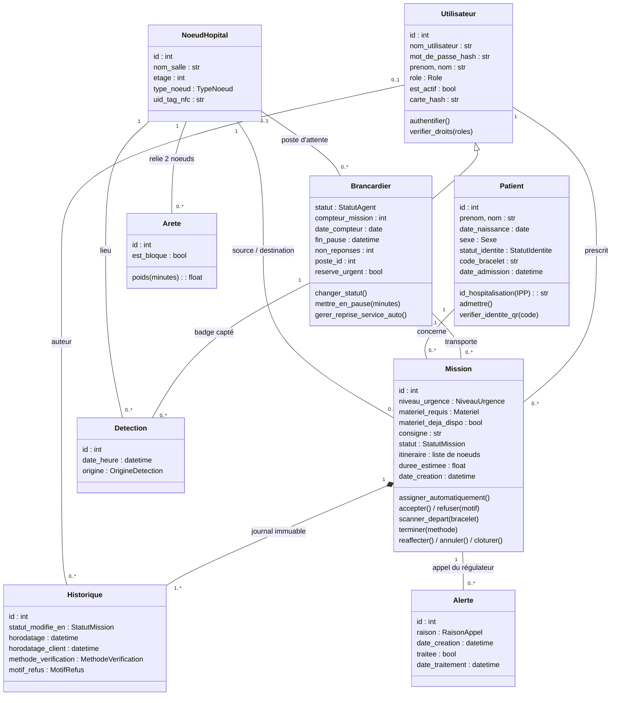

# Smart-Brancard / Cardio-Connect — ce qui a été réalisé

École Polytechnique de Thiès · Fatou Cissé Ndong et Aïssatou Seck · encadrants : M. Seck, Mme Ngom, M. Gueye, M. Sidibé

Ce document reprend tout le projet, sprint par sprint. Pour chaque réalisation, il dit **ce qui a été fait**, **avec quoi** (technologies, bibliothèques), et **comment** (méthode, règles). Il sert de base au rapport et à la présentation finale.

---

## 1. Le problème et les objectifs

**Le problème.**
- Dans un hôpital, le transport des patients entre services repose sur des appels téléphoniques et la mémoire d'un coordinateur.
- Les retards s'enchaînent faute de coordination, et les urgences se saturent faute de transferts rapides.
- Les coordinateurs et les brancardiers sont surchargés.
- On ne sait pas toujours qui a transporté quel patient, ni quand.

**Les objectifs du cahier des charges (CDC) :**
1. **Automatiser l'assignation** des missions au bon brancardier.
2. **Tracer chaque étape** du transport et garantir le bon patient (identitovigilance).
3. **Réduire la charge cognitive** des équipes.
4. **Lever les barrières d'accessibilité** par la voix.

**Ce que fait l'application.**
1. Un médecin (ou un infirmier) demande un transport.
2. Le serveur calcule l'itinéraire le plus rapide dans l'hôpital, puis propose la mission au brancardier le mieux placé.
3. Le brancardier est prévenu par une sonnerie et une voix. Il accepte, puis scanne le bracelet du patient. Son badge prouve qu'il est arrivé.
4. Le régulateur supervise la flotte en temps réel.
5. Chaque étape est inscrite dans un journal qu'on ne peut pas modifier.

---

## 2. Méthode de travail

| Élément | Choix |
|---|---|
| Méthode | **Scrum** en binôme, 6 sprints de 2 semaines (sprints 0 à 5) |
| Répartition | **Alternée** : la développeuse A fait le backend d'un sprint pendant que la développeuse B fait le frontend, puis les rôles s'inversent au sprint suivant. Les deux connaissent tout le code |
| Suivi | Feuille de route versionnée (`docs/feuille-de-route-v3.html`), mise à jour à chaque sprint, avec les décisions et leur justification |
| Code | Dépôt GitHub partagé : une branche par fonctionnalité (`feature/<prénom>/<sujet>`), des **pull requests** relues avant fusion dans `main` (numérotées jusqu'à la #23 à la fin du Sprint 5) |
| Messages de commit | Convention `feat`, `fix`, `docs`, `test` suivie du domaine, en français |
| Qualité | Tests automatiques à chaque PR : `pytest` pour le backend, `eslint` et la construction Vite pour le frontend |
| Référence | Chaque fonctionnalité renvoie à sa section du cahier des charges (par exemple « CDC §5.4 ») |

---

## 3. Architecture

```
 Téléphone du brancardier (PWA)      Navigateur du régulateur et du médecin
          │                                          │
          └──────────────────┬───────────────────────┘
                             │ HTTPS : /api (REST) et /api/ws (WebSocket)
                     ┌───────▼────────┐
                     │     nginx      │  sert l'application React construite
                     └───────┬────────┘
                             │
                     ┌───────▼────────┐        ┌───────────────┐
                     │ FastAPI (API)  │◄──────►│ Redis Pub/Sub │  temps réel entre processus
                     │ 2 processus    │        └───────────────┘
                     └───────┬────────┘
                             │ SQLAlchemy
                     ┌───────▼────────┐
                     │ PostgreSQL +   │  comptes, patients, missions, plan de l'hôpital,
                     │ PostGIS        │  positions, journal d'audit immuable
                     └────────────────┘
   Simulateur de badges (écran du régulateur) ──► POST /detections/badge
   (dans un vrai hôpital : récepteurs ESP32 dans les salles)
```

- **Backend :** une API REST découpée en couches.
  - `models/` : les tables (SQLAlchemy) ;
  - `schemas/` : les données reçues et renvoyées (Pydantic) ;
  - `routes/` : les droits d'accès et les réponses ;
  - `services/` : la logique métier ;
  - `migrations/` : l'évolution du schéma (Alembic).
- **Frontend :** une seule application React pour les trois rôles, installable comme une application mobile (PWA).
  - `pages/` : un fichier par écran ;
  - `components/` ;
  - `services/` : les appels à l'API ;
  - `hooks/`.
- **Le serveur est installé dans l'hôpital,** sur le réseau local : une coupure d'Internet n'arrête rien.

---

## 4. Modèle de données final (diagramme de classes)

C'est le diagramme réellement codé, différent du diagramme initial (voir les écarts plus bas).



**Énumérations partagées par le backend et le frontend :**

| Énumération | Valeurs |
|---|---|
| `Role` | REGULATEUR, MEDECIN, BRANCARDIER, ADMIN |
| `StatutAgent` | DISPONIBLE, EN_MISSION, EN_PAUSE, INDISPONIBLE |
| `StatutMission` | EN_ATTENTE → PROPOSE → ACCEPTE → EN_TRANSIT → TERMINE (ou ANNULE) |
| `NiveauUrgence` et délai garanti | URGENT 3 min, HAUTE 8 min, MOYENNE 15 min, BASSE 30 min |
| `MethodeVerification` | SCAN_CODE_QR, BADGE_NFC, MANUEL, FORCE_URGENCE, BALISE (arrivée prouvée par le badge) |
| `MotifRefus` | MATERIEL_DEFECTUEUX, INDISPONIBILITE_PHYSIQUE, URGENCE_PRIORITAIRE, FIN_SERVICE |
| `OrigineDetection` | BADGE, SCAN (prouvent la présence), DECLARATION (ne prouve rien) |

**Écarts avec le diagramme de conception initial, et pourquoi :**

| Écart | Raison |
|---|---|
| **Nouveau statut ACCEPTE** entre PROPOSE et EN_TRANSIT | Distinguer « l'agent a accepté et rejoint le patient » de « le patient est en route » |
| **Ajouts au Patient :** date de naissance, sexe, statut d'identité, date d'admission | Distinguer les homonymes, et admettre un patient inconscient sous une identité provisoire |
| **Ajouts à la Mission :** consigne, itinéraire, durée estimée | Afficher le trajet et l'heure d'arrivée prévue |
| **Ajouts au Brancardier :** fin de pause, non-réponses, carte de connexion, poste d'attente, réservé aux URGENT | Pauses à durée fixe, gestion des agents qui ne répondent pas, connexion par carte, agents postés (Sprint 5) |
| **Nouvelles classes** Arete, Alerte, origine des détections | Le graphe a besoin de liens qu'on peut bloquer ; l'agent doit pouvoir appeler le régulateur ; seul un badge prouve la présence |
| **JournalAssistance** gardé mais pas utilisé | La dictée vocale (Whisper) est passée en perspective |
| **Méthodes placées dans des services** (`services/*.py`) plutôt que dans les classes | Garder les modèles simples et tester la logique à part |

---

## 5. Cas d'utilisation (version finale)

| Acteur | Cas d'utilisation réalisés |
|---|---|
| **Médecin / prescripteur** | Se connecter · Admettre un patient (identité provisoire possible) · Créer une demande de transport (urgence, départ, arrivée, matériel, consigne) · Suivre ses demandes (agent, position, arrivée estimée) |
| **Brancardier** | Se connecter par carte QR · Recevoir l'annonce (sonnerie, vibration, voix) · Accepter ou refuser avec un motif · Scanner le bracelet (« include » : vérifier le bon patient) · Forcer le départ en URGENT (« extend ») · Arrivée détectée par le badge (secours : scan de la salle, bouton « Arrivé ») · Appeler le régulateur · Gérer sa disponibilité et ses pauses · Consulter son journal du jour |
| **Régulateur** | Superviser la flotte en temps réel · Réaffecter, annuler ou clôturer une mission · Recevoir les alertes (saturation, appels, sans candidat) · Bloquer un ascenseur ou un couloir · Gérer les comptes, les cartes, le poste d'attente et la réservation aux URGENT · Faire tourner le simulateur de badges |
| **Système** (acteur secondaire) | Calculer l'itinéraire (Dijkstra) · Assigner automatiquement · Réaffecter après un refus ou une non-réponse · Reprendre les agents en fin de pause · Détecter l'arrivée par le badge · Diffuser les changements en temps réel |

**Retirés par rapport au diagramme initial :**
- « Dicter une mission vocale » et « Transcrire l'audio » : la dictée vocale est en perspective.
- « Consulter les prédictions de charge » : remplacé par l'analyse de la file d'attente, faite hors application.
- « Déployer des agents selon les recommandations » : devenu « Régler le poste d'attente et la réservation ».

---

## 6. Réalisations, sprint par sprint

### Sprint 0 — Environnement
| Réalisation | Avec quoi | Comment |
|---|---|---|
| Dépôt commun | Git, GitHub | Un `.gitignore` commun à Python et Node.js, des branches par fonctionnalité |
| Base et cache | Docker Compose, PostgreSQL 16 + PostGIS 3.4, Redis 7 | `docker compose up -d` démarre les deux. Les ports et les identifiants se règlent dans `.env` |

### Sprint 1 — Authentification et données
| Réalisation | Avec quoi | Comment |
|---|---|---|
| Modèles Utilisateur, Mission, Patient | SQLAlchemy 2 | **Héritage** : un Brancardier est un Utilisateur avec sa propre table |
| Inscription, connexion, profil | FastAPI, Pydantic 2 | `POST /auth/register` (réservé au régulateur), `POST /auth/login`, `GET /auth/me` |
| Mots de passe | bcrypt | Seule l'empreinte est stockée, jamais le mot de passe |
| Jetons | JWT (python-jose), HS256 | Valables 8 h, une garde. Le rôle est dans le jeton |
| Contrôle d'accès par rôle (RBAC) | Dépendance FastAPI `require_role([...])` | Chaque route déclare les rôles autorisés, sinon la réponse est 403 |
| Premier régulateur | `seed.py` | Script en ligne de commande, mot de passe saisi sans écho |
| Application React et connexion | React, Vite, Tailwind CSS, React Router | Écran de connexion par profil, jeton gardé dans le navigateur, pages protégées par rôle (`RouteProtegee`) |

### Sprint 2 — Missions et itinéraires
| Réalisation | Avec quoi | Comment |
|---|---|---|
| Évolutions de la base | Alembic | Une migration par changement, appliquée par `alembic upgrade head` (15 migrations au total) |
| Plan de l'hôpital | Fichier JSON chargé en base | **20 lieux sur 2 niveaux** : 8 services, 6 couloirs, 4 nœuds d'ascenseur, 2 dépôts de matériel. Le poids des arêtes est un temps en minutes, attente de l'ascenseur comprise. Pas d'escalier, car un brancard prend l'ascenseur |
| Itinéraire le plus rapide | **Dijkstra** avec NetworkX | Le graphe est reconstruit depuis la base ; les arêtes bloquées en sont exclues. Exemple : Urgences → Réanimation, 5,0 min par l'ascenseur B ; 7,0 min par l'ascenseur A si le B est en panne |
| Blocage d'un ascenseur ou d'un couloir | `PATCH /aretes/{id}` | Réservé au régulateur. Les missions suivantes contournent le passage bloqué |
| Création d'une mission | `POST /missions/create` | L'itinéraire et la durée estimée sont calculés et enregistrés |
| Admission des patients | Service d'admission | IPP sur 8 chiffres et bracelet `QR-<IPP>` générés. Les homonymes sont détectés. Un patient inconscient reçoit l'identité provisoire « INCONNU X-<IPP> ». Aucune donnée clinique (CDC §7.2) |
| **Journal d'audit immuable** | Table `historiques` et **déclencheur PostgreSQL** | Chaque changement de statut ajoute une ligne horodatée (auteur, méthode, motif). Le déclencheur refuse toute modification ou suppression (CDC §7.3) |
| Application installable | vite-plugin-pwa (Workbox) | Manifeste et service worker. Seuls les fichiers de l'application sont mis en cache, **jamais les réponses de l'API** |
| Dashboard et interface du médecin | React | File des missions triée par urgence, itinéraire en étapes, formulaire de demande et suivi |

### Sprint 3 — Affectation intelligente et application mobile
| Réalisation | Avec quoi | Comment |
|---|---|---|
| Position des agents | Table `detections` | La position d'un agent est sa dernière détection. Au-delà de 10 min, elle est considérée comme inconnue |
| **Attribution automatique** | Service d'assignation et Dijkstra | Le serveur fait **un seul Dijkstra depuis le point de départ** vers tous les lieux. Chaque agent disponible reçoit le score `trajet (min) + k × missions du jour`, et le plus petit score gagne. k = 0,5 pour l'**équité de charge** ; k = 0 en URGENT, où seule la distance compte. Un agent sans position récente passe en dernier |
| Jamais deux agents sur une mission | `SELECT … FOR UPDATE (SKIP LOCKED)` et **index unique** | La mission et les candidats sont verrouillés pendant le choix. Un index unique interdit à un agent d'avoir deux missions actives |
| Réponse de l'agent | Délais de 30, 45 ou 60 s selon l'urgence | Un refus se fait avec un des 4 motifs. Après un refus ou une non-réponse, l'agent est **exclu 5 min** de cette mission. Après **2 non-réponses**, il devient INDISPONIBLE. Une tâche de fond passe toutes les 5 s |
| Scans | Caméra (getUserMedia et **jsQR**), **Web NFC** (Chrome Android), QR de secours, saisie au clavier | Départ : tag de la salle et bracelet. Arrivée : tag de la salle. En URGENT, le départ sans scan est possible, mais tracé (`FORCE_URGENCE`) |
| Régulation manuelle | Routes `reaffecter` et `annuler` | Réservées au régulateur, tracées au journal |
| Application du brancardier | React, interface mobile | Onglets Mission, Journal, Profil. Mission proposée avec compte à rebours. Parcours en 5 étapes |
| Test sur un vrai téléphone | Vite en HTTPS (certificat auto-signé) et proxy `/api` | La caméra et le NFC exigent le HTTPS |

### Sprint 4 — Parcours à gestes réduits, hors ligne, temps réel
**Idée directrice :** ne demander à l'agent que les gestes qu'aucun capteur ne peut faire à sa place. On passe de **5 gestes dont 3 scans** à **2 gestes dont 1 scan** (accepter, puis scanner le bracelet).

| Réalisation | Avec quoi | Comment |
|---|---|---|
| **Badges BLE simulés** | `POST /detections/badge` et l'écran **Simulateur** | Dans un vrai hôpital, un récepteur par salle (ESP32) signale le badge de l'agent. Ici, le régulateur pose les agents sur le plan, et le simulateur envoie leur position toutes les 5 s. Le serveur ne fait pas la différence |
| Preuve de présence | Origine de chaque détection | Seuls BADGE et SCAN prouvent qu'un agent est dans une salle, et seulement s'ils datent de moins de 2 min. Ce que l'agent déclare lui-même ne prouve rien |
| **Bracelet seul au départ** | Scan de départ | Si le badge prouve la présence en salle, le bracelet suffit. Le tag de la salle reste en secours |
| **Arrivée détectée** | Règle des 30 s | Un badge présent **30 s sans interruption** dans la salle d'arrivée termine la mission (méthode `BALISE`). Un simple passage dans le couloir ne compte pas. L'agent redevient disponible quand il sort de la salle, ou au plus tard 10 min après |
| Secours | Bouton « Arrivé », clôture par le régulateur | Chaque clôture est tracée, avec sa méthode |
| **Annonce vocale** | Web Audio (sonnerie), Vibration API, **speechSynthesis** en français | Le navigateur bloque le son avant un premier toucher : un bouton « Activer le son » apparaît à l'ouverture. Les motifs de refus sont en images et lus à voix haute. Au scan, la voix dit « Bon patient » ou « Mauvais patient » |
| Appel du régulateur | Table `alertes` | Après plusieurs scans refusés ou un bracelet illisible, l'agent appelle le régulateur, sans créer de doublon. Le régulateur marque l'alerte comme traitée |
| Pauses | 30 ou 45 min | Une pause est refusée si elle laisse moins de `MIN_AGENTS_DISPONIBLES` agents disponibles. Le serveur remet l'agent en service à la fin, même si son téléphone est éteint |
| **Connexion par carte** | Code secret aléatoire, empreinte SHA-256, QR (bibliothèque `qrcode`) | Le régulateur imprime la carte. Le code n'est montré qu'une fois. Une nouvelle carte rend l'ancienne inutilisable |
| **Hors ligne** | `localStorage` et file d'actions | Le téléphone garde la mission en cours. Les actions faites sans réseau attendent, puis partent dans l'ordre avec leur **heure réelle** (`horodatage_client`), sans être comptées deux fois. Tout est effacé à la déconnexion |
| **Temps réel** | WebSocket `/ws` et **Redis Pub/Sub** | À chaque validation en base, des écouteurs SQLAlchemy repèrent les tables modifiées. Le serveur envoie seulement le **sujet** (`missions`, `agents`, `alertes`, `graphe`), et chaque écran relit ses données par les routes HTTP, qui vérifient les droits : aucune donnée patient ne passe par le WebSocket. Le jeton est envoyé dans le premier message, jamais dans l'adresse. Redis relie les processus du serveur. Les écrans se rechargent aussi toutes les 30 s, en secours |
| **File d'attente avec vieillissement** | Clé de tri | L'URGENT passe d'abord. Ensuite vient l'échéance la plus proche (création + délai garanti) : une BASSE qui attend depuis 25 min passe devant une MOYENNE qui vient d'arriver |
| **Saturation de la flotte** | `GET /missions/saturation` | Alerte quand au moins 3 missions attendent et qu'il y en a plus que d'agents capables de les prendre. Un bandeau rouge s'affiche au dashboard |
| Comptes | Page Comptes | Recherche par nom ou prénom (sans accents), impression des cartes, désactivation (jamais de suppression) |
| Admission et « Mes demandes » | Interface du médecin | Admettre un patient introuvable, choisir en cas d'homonyme, retrouver ses demandes |

### Sprint 5 — Charge, dimensionnement, sécurité, livraison
| Réalisation | Avec quoi | Comment |
|---|---|---|
| **Données réelles** | Annuaires statistiques du MSAS 2020-2021, Hôpital Général Idrissa Pouye | 12 615 hospitalisations en 2021, soit environ 35 admissions par jour. On suppose 3 transports par séjour (testé de 2 à 4), dont 75 % en journée et un pic à ×1,5. Répartition : 5 % URGENT, 15 % HAUTE, 40 % MOYENNE, 40 % BASSE. Ces données remplacent MIMIC-III, plus proches du contexte sénégalais |
| **Tests de charge** | **Locust** 2.32 | De faux brancardiers, médecins et régulateurs utilisent la vraie API : 90 % d'acceptations, badges envoyés par la route du simulateur. Le temps est accéléré en gardant les proportions (×60 pour le test à 50 agents, ×15 pour le test réaliste comparé à la simulation). **À 50 agents (essai de 2 min) : 5 680 requêtes, 0 erreur, médiane 25 ms, 95 % en moins de 120 ms** |
| **Analyse de la file d'attente** | Modèle **M/M/c à priorités** (formule de Cobham) et **simulation à événements discrets** | La simulation reproduit les règles de l'application : plan du prototype, Dijkstra, score, refus, durées. Il faut **4 agents en journée, 5 au pic, 3 la nuit** pour tenir 95 % des HAUTE, MOYENNE et BASSE dans leur délai. Locust confirme les résultats |
| Constat sur les URGENT | Simulation | Avec 4 agents, seulement 48 % des URGENT sont pris en charge en 3 min. **Le problème est la position des agents, pas leur nombre** |
| **Agents postés, réservés aux URGENT** | Colonnes `poste_id` et `reserve_urgent`, page Comptes | Un agent réservé ne reçoit que des URGENT, et une URGENT va au plus proche, réservé ou non. Le poste dit à l'agent où attendre entre deux missions. **Avec 6 agents, dont 2 postés au centre des étages et réservés : 94 % des URGENT en 3 min, contre 68 % sans poste** |
| **Matrice de sécurité** | pytest et schéma OpenAPI | Pour chaque route, les rôles autorisés sont déclarés. Les tests vérifient le 403, le 401 (sans jeton, jeton faux, compte désactivé) et l'isolement entre médecins. Une route oubliée fait échouer les tests |
| **Lancement en une commande** | **Docker** (Dockerfiles), Docker Compose, nginx | `docker compose up --build` lance la base, Redis, l'API et l'application. Au démarrage : attente de la base, migrations, plan, données de démonstration, puis l'API sur 2 processus. nginx sert l'application et transmet `/api` et le WebSocket, en HTTP (8088) et en HTTPS (8443) pour les téléphones |
| **Démonstration** | `seed_demo.py`, `docs/demo/bracelets.html`, `docs/scenario-demonstration.md` | 1 régulateur, 2 médecins, 6 brancardiers (4 polyvalents et 2 postés réservés), 8 patients avec bracelet. Un scénario pas à pas d'environ 15 min |

---

## 7. Règles métier, en résumé

1. **Choix de l'agent :** le plus petit score `trajet + 0,5 × missions du jour` (trajet seul en URGENT), parmi les agents actifs et disponibles. Un agent réservé aux URGENT n'est candidat que pour une URGENT.
2. **Ordre de la file :** l'URGENT d'abord, puis l'échéance la plus proche (vieillissement).
3. **Réponse :** 30, 45 ou 60 s selon l'urgence. Un refus ou un silence exclut l'agent 5 min de cette mission. Deux silences de suite le rendent indisponible.
4. **Identitovigilance :** le transport ne démarre qu'avec le bon bracelet. Seule exception : le forçage en URGENT, tracé.
5. **Présence :** prouvée par un badge ou un scan de moins de 2 min. Arrivée : 30 s de présence en salle.
6. **Pauses :** 30 ou 45 min, refusées s'il ne resterait pas assez d'agents disponibles.
7. **Saturation :** au moins 3 missions en attente, et plus que d'agents capables de les prendre.
8. **Traçabilité :** journal immuable. Un compte est désactivé, jamais supprimé.
9. **Confidentialité :** aucune donnée clinique, rien de l'API en cache sur le téléphone, rien de sensible dans le WebSocket.

---

## 8. Technologies utilisées

| Domaine | Technologie | Rôle dans le projet |
|---|---|---|
| Langage serveur | Python 3.12 | Backend, scripts, analyse |
| API | **FastAPI**, Uvicorn | Routes REST asynchrones, WebSocket, documentation Swagger automatique |
| Validation | Pydantic 2 | Données reçues et renvoyées |
| Accès aux données | **SQLAlchemy 2**, Alembic, psycopg2 | Modèles, verrous, migrations |
| Base de données | **PostgreSQL 16 + PostGIS** | Données, contraintes, déclencheur d'immuabilité |
| Temps réel | **Redis 7** Pub/Sub, WebSocket | Diffusion des changements entre processus et écrans |
| Graphes | **NetworkX** (Dijkstra) | Itinéraires et distances |
| Sécurité | JWT (python-jose), bcrypt, SHA-256, RBAC | Connexion, rôles, cartes |
| Frontend | **React 19**, **Vite 8**, Tailwind CSS 4, React Router 7, lucide-react | Interfaces des trois rôles |
| Mobile | **PWA** (vite-plugin-pwa / Workbox), jsQR, qrcode, Web NFC, getUserMedia, Web Audio, Vibration, speechSynthesis | Application installable, scans, annonces vocales |
| Tests | **pytest** (215 tests), ESLint | Non-régression, sécurité |
| Charge | **Locust** | Tests de charge |
| Analyse | Python (file M/M/c, simulation à événements) | Dimensionnement de la flotte |
| Déploiement | **Docker**, Docker Compose, **nginx** | Lancement en une commande, HTTPS |
| Organisation | Git, GitHub (pull requests), Scrum | Travail en binôme |

---

## 9. Résultats chiffrés

| Indicateur | Valeur |
|---|---|
| Tests automatiques du backend | **215**, tous réussis (145 à la fin du Sprint 3) |
| Gestes du brancardier par mission | **5 → 2**, scans **3 → 1** |
| Charge à 50 agents | 5 680 requêtes, **0 erreur**, médiane **25 ms**, 95 % **< 120 ms** |
| Scénario réaliste (8 agents) | 11 822 requêtes, 99 % **< 180 ms** |
| Flotte nécessaire | 4 agents en journée, 5 au pic, 3 la nuit |
| URGENT prises en charge en 3 min | **68 % → 94 %** avec 2 agents postés réservés (6 agents) |
| Trajet de référence | Urgences → Réanimation : 5,0 min, ou 7,0 min si l'ascenseur B est en panne |

---

## 10. Limites

- **Badges simulés :** un vrai badge BLE peut être capté à travers un mur, et le seuil de 30 s n'a pas été validé sur place.
- **Plan simplifié :** 2 niveaux, des temps de couloir estimés, pas le plan réel de l'HOGIP.
- **Données de 2020-2021 :** ce sont les années de la COVID. Le nombre de transports par séjour et l'origine des URGENT sont des hypothèses.
- **Un smartphone par agent :** le budget des hôpitaux ne le garantit pas.
- **Application web :** elle ne sonne que si elle est ouverte, et ne vibre pas sur iPhone.
- **Serveur ou Wi-Fi en panne :** aucune attribution n'est possible ; il faut une procédure de secours (téléphone, papier).
- **Pas d'essai avec de vrais agents :** le gain de temps sur le terrain n'est pas mesuré.

## 11. Perspectives

- **Dictée vocale** du médecin (Whisper) : la table `journaux_assistance` est déjà prête.
- **Annonces en wolof.**
- **Notifications push** (Firebase), ou une application Android native.
- **Vrais badges BLE et récepteurs ESP32**, sur 2 ou 3 salles. Le serveur ne change pas.
- **Refaire l'analyse** avec le plan réel et des relevés de quelques semaines.
- **Graphiques de performance** et prédiction des pics d'activité.
- **HTTPS de production** et mode hors ligne complet.
